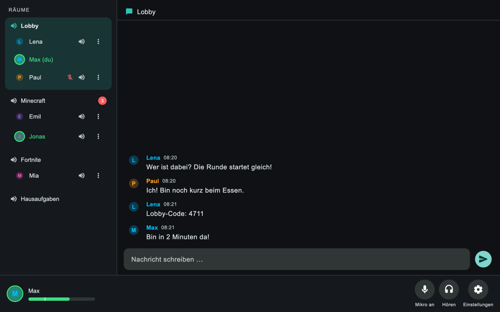
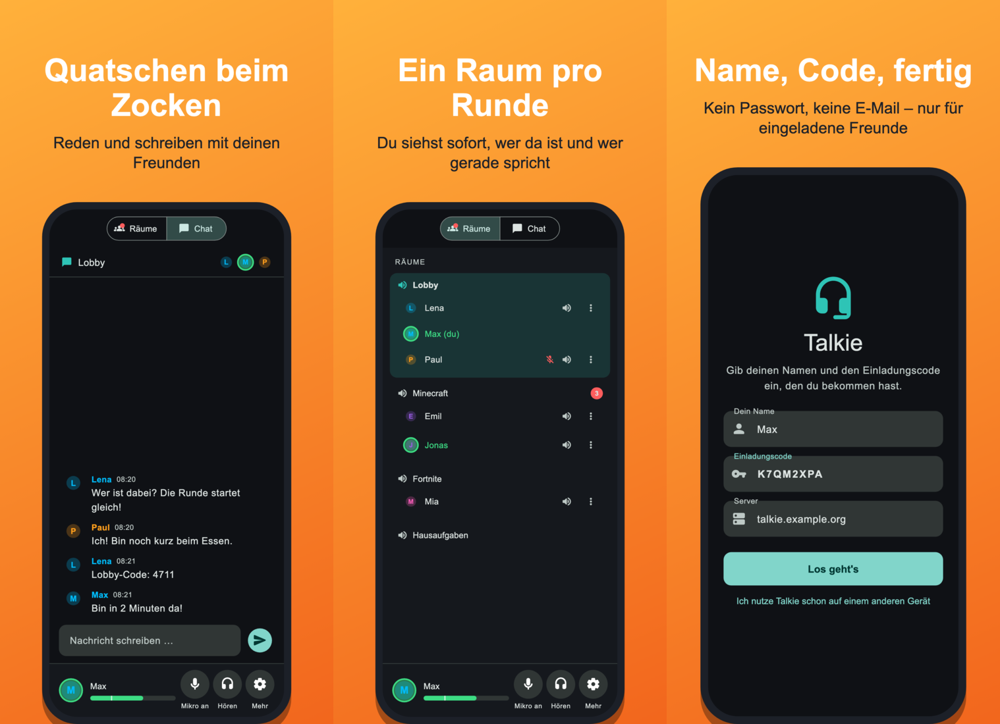
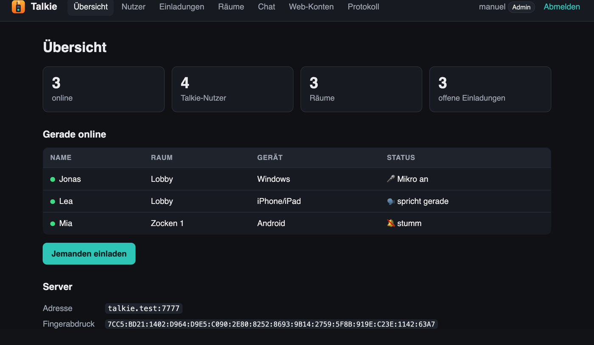
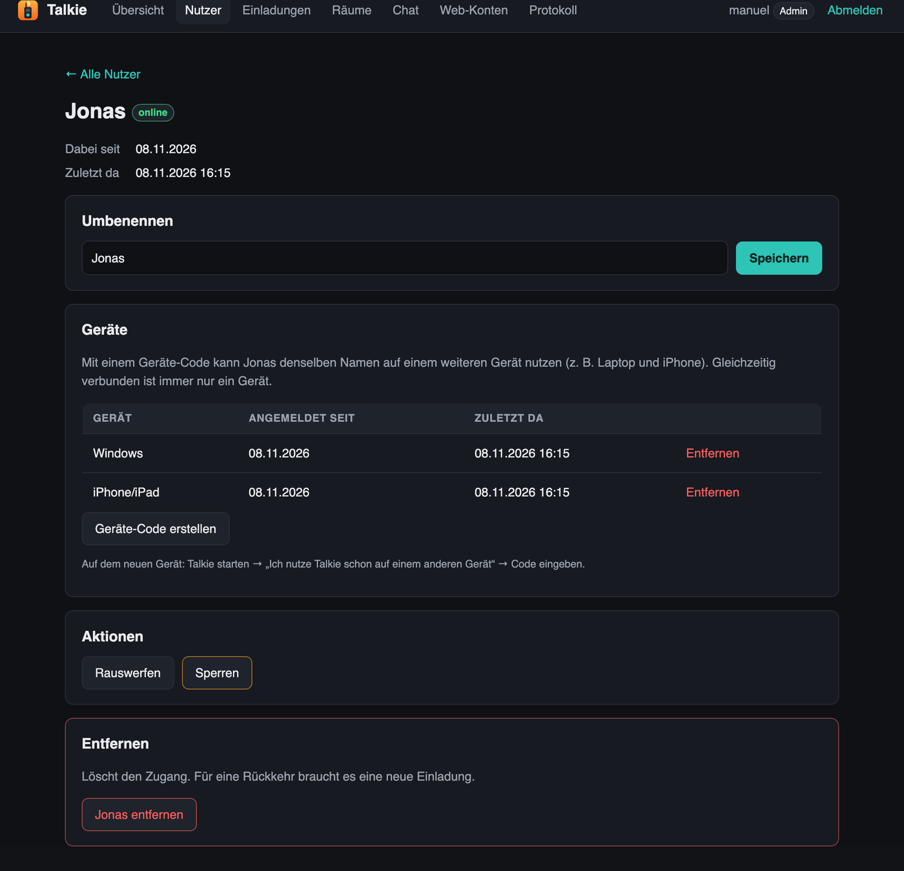
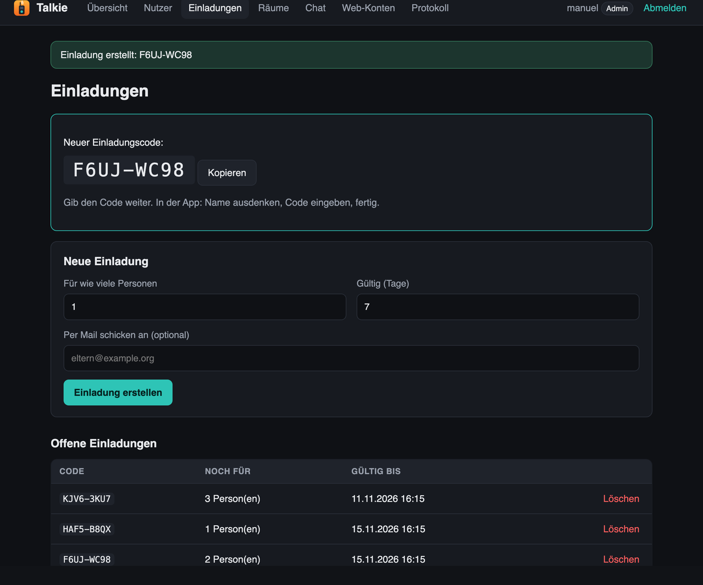
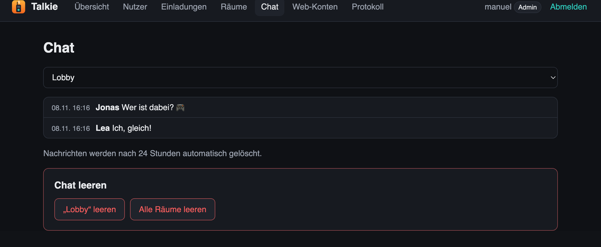

# Talkie

**Talkie ist ein Sprach- und Text-Chat für Freunde und Familie** – gebaut für Kinder, die beim Zocken
miteinander reden wollen, ohne dass dafür ein großer Dienst wie Discord nötig ist.

Ihr betreibt Talkie selbst: Ein kleiner Server läuft bei euch zu Hause oder auf einem gemieteten Server,
die Kinder installieren die App, geben ihren Namen und einen Einladungscode ein – fertig. Fremde kommen
nicht hinein, Werbung und Tracking gibt es nicht, und alle Daten bleiben bei euch.

<p align="center"></p>

## Was kann Talkie?

- 🎙️ **Einfach reden:** Sobald du sprichst, hören dich die anderen im Raum – keine Taste nötig.
  Wer lieber eine Taste drückt, schaltet „Push-to-Talk“ ein (funktioniert auch, während ein Spiel läuft).
- 🏠 **Räume:** z. B. „Lobby“, „Minecraft“, „Hausaufgaben“. Ein Tipp auf den Raum, und du bist drin.
  Du siehst sofort, wer da ist und wer gerade spricht.
- 💬 **Chat pro Raum** für Lobby-Codes, Links und „bin gleich da“. Nachrichten verschwinden nach 24 Stunden.
- 🔇 **Stumm, taub, leiser:** Mikro aus, niemanden hören, oder einzelne Personen nur für dich leiser oder stumm schalten.
- 📱 **Auf allen Geräten** – und mit demselben Namen auf mehreren (z. B. Laptop und Handy).
- 🎧 **Gut verständlich und sparsam:** Rauschfilter gegen Lüfter und Tastatur, Echo-Unterdrückung am Handy.
  Talkie braucht nur etwa 3 KB pro Sekunde und Sprecher – das Spiel merkt davon nichts.
- 🔒 **Sicher:** Nur wer eingeladen ist, kommt rein. Alles ist verschlüsselt, ohne Passwörter, ohne E-Mail-Adressen der Kinder.

<p align="center"></p>

## Für welche Geräte?

| Gerät | ab Version | Download |
|---|---|---|
| 🪟 Windows | Windows 10 | [Releases](https://github.com/ManuelW77/talkie/releases/latest) → `Talkie-Windows.zip` |
| 🍎 Mac | macOS 10.15 (Intel und Apple Silicon) | [Releases](https://github.com/ManuelW77/talkie/releases/latest) → `Talkie-macOS.dmg` |
| 🐧 Linux | 64 Bit (x64) | [Releases](https://github.com/ManuelW77/talkie/releases/latest) → `Talkie-Linux-x64.tar.gz` |
| 🤖 Android | Android 8.0 | [Releases](https://github.com/ManuelW77/talkie/releases/latest) → `Talkie-Android.apk` |
| 📱 iPhone / iPad | iOS 15 | [TestFlight](https://testflight.apple.com/join/zfBAJJNK) (erst die App „TestFlight“ aus dem App Store laden) |

**So kommst du rein:** App starten → deinen Namen und den Einladungscode eingeben, den du bekommen hast →
„Los geht's“. Ab dann verbindet sich Talkie beim Start von selbst.

## Für Eltern und Betreiber: die Verwaltungsseite

Im Browser verwaltest du alles: Einladungen erstellen (auch per Mail an die Eltern der Freunde), sehen,
wer online ist und wo, Räume anlegen, Nutzer umbenennen, rauswerfen oder sperren, den Chat lesen oder leeren.
Anmeldung per E-Mail-Code oder mit eurem eigenen Login (z. B. Pocket ID). Andere Eltern können eigene
Konten mit eingeschränkten Rechten bekommen (z. B. „nur Kinder einladen“).

<p align="center">
  
  
</p>
<p align="center">
  
  
</p>

🔐 **Datenschutz:** Talkie sammelt nichts für uns – alles liegt auf eurem Server. Details: [docs/DATENSCHUTZ.md](docs/DATENSCHUTZ.md) (English: [docs/PRIVACY.md](docs/PRIVACY.md)).

---

# Technik und Einrichtung

Ab hier geht es um den Betrieb des Servers und das Bauen der Apps.

- **Rein nur mit Einladungscode.** Danach meldet sich das Gerät automatisch an (Ed25519-Geräteschlüssel), ohne Passwort.
- **Verschlüsselt** (QUIC/TLS 1.3). Die Clients merken sich das Server-Zertifikat und verweigern einen fremden Server.
- **Datensparsam:** Opus mit 16 kbit/s, 40-ms-Pakete, gesendet wird nur beim Sprechen.
  Das sind etwa **25 kbit/s pro sprechender Person** (rund 11 MB pro Stunde Dauerreden), in Pausen nahezu 0.
- **Rauschfilter** (RNNoise), Sprachaktivierung oder Push-to-Talk, Echo-Unterdrückung des Systems am Handy.

```
server/   Go-Server (Docker), Verwaltung per Kommandozeile und im Browser
app/      Flutter-App (Windows, macOS, Linux, Android, iOS) mit Rust-Kern in app/rust
docs/     Protokoll, Release, Datenschutz, Screenshots
```

## 1. Server starten

Voraussetzung: Docker. Der Server braucht nur **einen UDP-Port: 7777**.

```bash
cd server
docker compose up -d
docker logs talkie        # zeigt den Fingerabdruck des Zertifikats
```

Läuft der Server zu Hause, muss im Router eine **Portfreigabe für UDP 7777** auf den Rechner mit Docker
eingerichtet werden. Für eine wechselnde IP braucht es zusätzlich einen DynDNS-Namen.
Einfacher geht es mit einem kleinen VPS (ca. 4 €/Monat).

### Verwaltung

Alle Befehle laufen im Container:

```bash
docker exec talkie talkie-server invite          # Einladungscode für 1 Person, 7 Tage gültig
docker exec talkie talkie-server invite 5 14     # für 5 Personen, 14 Tage
docker exec talkie talkie-server users           # wer ist registriert / online
docker exec talkie talkie-server kick Max        # rauswerfen (darf wiederkommen)
docker exec talkie talkie-server ban Max         # sperren
docker exec talkie talkie-server unban Max
docker exec talkie talkie-server rename Max Maxi
docker exec talkie talkie-server user-del Max    # Zugang löschen (braucht neue Einladung)
docker exec talkie talkie-server rooms
docker exec talkie talkie-server room-add "Minecraft"
docker exec talkie talkie-server room-del "Zocken 2"
docker exec talkie talkie-server chat Lobby 50   # letzte 50 Chatnachrichten eines Raums
docker exec talkie talkie-server status          # Fingerabdruck + Anzahl online
docker exec talkie talkie-server web-admin du@example.org   # Admin für die Verwaltungsseite (auch Notfall)
```

### Verwaltungsseite im Browser

Alles, was die Befehle oben können, geht auch bequem im Browser, auch für andere Eltern:
Kids einladen (auch per Mail), Nutzer umbenennen, rauswerfen, sperren und entfernen, Räume anlegen,
umbenennen, sortieren und löschen, den Chat mitlesen und (Admins) leeren. Ein Protokoll zeigt, wer was geändert hat.
Chatnachrichten werden nach 24 Stunden automatisch gelöscht (`TALKIE_CHAT_HOURS`, 0 = nie).
Gibt es ein neueres GitHub-Release, zeigen die Apps einen Hinweis „Neue Version“. Dafür fragt nur der Server
einmal täglich bei GitHub nach (`TALKIE_UPDATE_REPO`, leer = aus, oder fest: `TALKIE_LATEST_VERSION`).

**Konten und Rechte:** Die Web-Konten (mit E-Mail-Adresse) sind getrennt von den Talkie-Nutzern der Kids.
Es gibt zwei Gruppen:

- **Admin** darf alles, auch Web-Konten anlegen und Rechte vergeben.
- **Benutzer** darf nur, was der Admin anhakt: Kids einladen, Talkie-Nutzer bearbeiten/rauswerfen/sperren,
  Talkie-Nutzer entfernen, Räume verwalten, Chat mitlesen.

**Anmeldung** ohne Passwort, auf zwei Wegen (einer reicht):

- **Per Mail:** E-Mail-Adresse eingeben, dann kommt ein Link und ein 8-stelliger Code (15 Minuten gültig,
  5 Versuche). Braucht einen SMTP-Zugang.
- **Per OIDC:** z. B. Pocket ID, Authentik, Keycloak, Google. Angemeldet wird nur, wer als Web-Konto mit
  derselben (bestätigten) E-Mail-Adresse eingetragen ist. Beim ersten Login wird das Konto fest mit der
  Identität beim Anbieter verknüpft.

**Einrichten:**

1. `server/.env.example` nach `server/.env` kopieren und ausfüllen. Die `.env` enthält Passwörter und
   wird nicht committet.
2. `docker compose up -d` startet den Server neu. Das Admin-Konto aus `TALKIE_ADMIN_EMAIL` wird angelegt,
   solange es noch keinen Admin gibt.
3. Die Seite lauscht nur lokal auf Port 8003. Von außen erreichst du sie über einen Reverse-Proxy mit HTTPS,
   zum Beispiel Caddy:
   ```
   talkie.example.org {
       reverse_proxy 127.0.0.1:8003
   }
   ```
   `TALKIE_PUBLIC_URL` muss genau die Adresse sein, die im Browser steht.

**Pocket ID:** Unter *OIDC Clients* einen Client anlegen, Callback-URL
`https://talkie.example.org/auth/oidc/callback`. Client-ID und Secret in die `.env`, dazu
`TALKIE_OIDC_ISSUER=https://id.example.org` (die Pocket-ID-Adresse) und `TALKIE_OIDC_NAME=Pocket ID`.
Meldet die Seite „E-Mail-Adresse nicht bestätigt“, bestätigt der Anbieter die Adressen nicht.
Bei einem eigenen Anbieter, bei dem nur du Konten anlegst, kannst du das mit
`TALKIE_OIDC_ALLOW_UNVERIFIED=1` abschalten. Bei öffentlichen Anbietern lass es aus.

**Lokal ausprobieren:** `server/dev.sh up` startet den Server mit Verwaltungsseite und
[Mailpit](https://mailpit.axllent.org) als Mail-Fänger. Alle Mails (Login-Codes, Einladungen) landen dort
und gehen nicht raus.

- Verwaltung: http://localhost:8090, anmelden mit `admin@talkie.local`
- Mails: http://localhost:8026
- Stoppen: `server/dev.sh down`

**Ausgesperrt?** `docker exec talkie talkie-server web-admin du@example.org` macht das Konto wieder zum
aktiven Admin.

Alle Daten (Datenbank, Zertifikat) liegen im Docker-Volume `talkie-data`.
**Wird das Volume gelöscht, entsteht ein neues Zertifikat.** Dann verweigern alle Clients die Verbindung
(Schutz gegen fremde Server) und müssen sich mit „Gerät abmelden“ und einem neuen Code neu einrichten.
Deshalb das Volume sichern:

```bash
docker run --rm -v server_talkie-data:/data -v "$PWD":/backup alpine tar czf /backup/talkie-backup.tgz -C /data .
```

---

## 2. Clients bauen

Am einfachsten über **GitHub Actions** (`.github/workflows/build.yml`). Jeder Push baut:

| Datei | System |
|---|---|
| `Talkie-macOS.dmg` | macOS ab 10.15, Intel **und** Apple Silicon (läuft also auch auf Big Sur) |
| `Talkie-Windows.zip` | Windows 10 und 11 (64 Bit), Laufzeit-DLLs liegen bei |
| `Talkie-Linux-x64.tar.gz` | Linux x64 (braucht GTK 3 und ALSA, ist auf gängigen Desktops vorhanden) |
| `Talkie-Android.apk` | Android ab 8.0, direkt installierbar (nicht über den Play Store) |

iPhone/iPad (ab iOS 15): über TestFlight, siehe oben – nicht über die Actions.

**Tipp:** Unter *Settings → Secrets and variables → Actions → Variables* im Repo
`TALKIE_SERVER` (z. B. `talkie.example.org:7777`) und `TALKIE_FINGERPRINT` (aus `talkie-server status`) setzen.
Dann ist der Server fest eingebaut und die Kids geben **nur Name und Einladungscode** ein.
Mit dem Fingerabdruck ist der Client sogar beim allerersten Verbinden gegen fremde Server geschützt.

Ein Tag `v1.0.0` pushen → die Dateien landen automatisch in einem GitHub-Release, die Mac-App
signiert und notarisiert (siehe [docs/RELEASE.md](docs/RELEASE.md)).

### Lokal bauen

Voraussetzungen: Flutter 3.44, Rust (rustup), cmake; unter Linux zusätzlich `libasound2-dev libgtk-3-dev`.

```bash
cd app
flutter_rust_bridge_codegen generate     # nur nach Änderungen an app/rust/src/api
tool/build_macos.sh --dart-define=TALKIE_SERVER=talkie.example.org   # macOS
flutter build windows --release --dart-define=TALKIE_SERVER=...       # auf Windows
flutter build linux --release --dart-define=TALKIE_SERVER=...         # auf Linux
flutter build apk --release --dart-define=TALKIE_SERVER=...           # Android (braucht Android-SDK mit NDK)
tool/build_ios_sim.sh                                                 # iOS-Simulator
```

> **Android/iOS:** Dieselbe App läuft auch auf Handy und Tablet (Android ab 8.0, iOS ab 15).
> Rust-Ziele vorher installieren: `rustup target add aarch64-linux-android armv7-linux-androideabi
> x86_64-linux-android aarch64-apple-ios aarch64-apple-ios-sim`. iOS baut und signiert man in Xcode
> (nicht in der CI): einmal `cd app && flutter build ios --config-only --release`, dann
> `app/ios/Runner.xcworkspace` öffnen, Team unter *Signing* prüfen, *Product → Archive* und über den
> Organizer zu App Store Connect/TestFlight hochladen.

> **macOS mit Xcode 27:** Apple erlaubt damit nur noch macOS 12+ als Ziel, und das neue `lipo` verträgt
> Flutters Universal-Prüfung nicht. `tool/build_macos.sh` baut dann nur für den eigenen Mac.
> Die Version für ältere Macs (Big Sur, Intel) kommt aus der GitHub-Action, die Xcode 16 benutzt.

---

## 3. An die Kids verteilen

1. Einladungscode erzeugen: `docker exec talkie talkie-server invite`
2. Datei für das jeweilige System schicken und den Code dazu
3. Beim ersten Start: Name und Code eingeben → fertig. Ab dann startet Talkie direkt verbunden.

**Erster Start, weil die App nicht bei Apple/Microsoft registriert ist:**

- **macOS:** Talkie in „Programme“ ziehen und starten (Release-Versionen sind notarisiert; nur bei
  Test-Builds aus den Actions: **Rechtsklick → Öffnen → Öffnen**).
  Beim ersten Verbinden fragt macOS nach dem Mikrofon → „Erlauben“.
- **Windows:** Bei „Der Computer wurde durch Windows geschützt“ → **Weitere Informationen → Trotzdem ausführen**.
- **Linux:** Archiv entpacken, im Ordner `Talkie` einmal `./install.sh` ausführen → Talkie steht im
  Startmenü und hat sein Icon im Dock. Starten geht auch direkt mit `./talkie`.
- **Gleicher Name auf mehreren Geräten** (z. B. Laptop und iPhone): auf dem ersten Gerät unter
  „Einstellungen“/„Mehr“ → „Auf weiterem Gerät nutzen“ einen Code holen, auf dem neuen Gerät
  „Ich nutze Talkie schon auf einem anderen Gerät“ antippen und den Code eingeben. Admins können den
  Code auch auf der Verwaltungsseite beim Nutzer erstellen. Höchstens 5 Geräte, verbunden ist immer eins.
- **iPhone/iPad:** App „TestFlight“ installieren, dann https://testflight.apple.com/join/zfBAJJNK öffnen
  und „Annehmen“ / „Installieren“. Updates kommen über TestFlight von selbst.
- **Android:** APK aufs Handy schicken und öffnen, Installation aus dieser Quelle erlauben.
  Mikrofon und Benachrichtigungen erlauben: Die Benachrichtigung „Talkie ist verbunden“ hält Talkie
  im Hintergrund am Leben, während gezockt wird.
- **Handy allgemein:** Talkie nutzt die Echo-Unterdrückung von iOS/Android, damit es auch über den
  Lautsprecher geht (abschaltbar unter „Mehr“). Mit Kopfhörern klingt es trotzdem am besten.

**Push-to-Talk:** In den Einstellungen unter „Sprechen“ auf „Taste halten“ stellen und eine Taste wählen
(F1–F12, Strg/Alt/Umschalt, Maus-Seitentasten). Die Taste wirkt auch, während ein Spiel im Vordergrund ist
(macOS fragt dafür nach „Eingabeüberwachung“; unter Linux nur mit X11, nicht unter reinem Wayland).
Am Handy und zusätzlich überall: unten den Knopf „Halten“ gedrückt halten.

Bedienung: **Raum anklicken** = Raum wechseln. Mikrofon-Knopf = stumm (auch **Strg+M** bzw. **⌘M**),
Kopfhörer-Knopf = niemanden hören. In den Einstellungen lässt sich die Empfindlichkeit einstellen:
Beim normalen Sprechen soll der grüne Balken über den weißen Strich kommen.

---

## Entwicklung & Tests

```bash
cd server && go test -race ./...                       # Server inkl. echter QUIC-Verbindungen
cd app/rust && cargo test --lib                        # Kern: Opus, Jitter-Puffer, Protokoll, Schlüssel
cd app/rust && cargo run --example e2e -- 127.0.0.1:7777 CODE   # Ende-zu-Ende gegen laufenden Server
cd app && flutter test                                 # Oberfläche
```

`CODE` muss für mindestens 2 Personen gelten: `talkie-server invite 3 1`.

### Architektur kurz

- **Transport:** ein QUIC-Port. Steuerung und Chat laufen als JSON über einen Stream, Sprache als QUIC-Datagramme
  (unzuverlässig, ohne Verzögerung). Details in [docs/PROTOCOL.md](docs/PROTOCOL.md).
- **Anmeldung:** Jedes Gerät hat einen Ed25519-Schlüssel. Bei der Registrierung wird ein Einladungscode verbraucht.
  Danach unterschreibt der Client eine Zufallszahl vom Server, gebunden an dessen Zertifikat.
  Nach 10 Fehlversuchen ist eine IP für 10 Minuten gesperrt.
- **Server:** leitet Sprache nur an Leute im selben Raum weiter, nicht an „taube“ Nutzer und nicht von „stummen“.
  Chat-Verlauf: die letzten 200 Nachrichten pro Raum.
- **Client-Kern (Rust):** cpal (Audio), Opus, nnnoiseless (Rauschfilter + Spracherkennung), Jitter-Puffer mit
  Verlustverschleierung, quinn (QUIC). Die Flutter-Oberfläche spricht über flutter_rust_bridge mit dem Kern.

## Lizenz

Talkie steht unter der [GNU General Public License v3.0](LICENSE). Du darfst es nutzen, ändern und weitergeben. Weitergegebene Versionen müssen ebenfalls unter der GPL-3.0 stehen und ihren Quellcode offenlegen.
